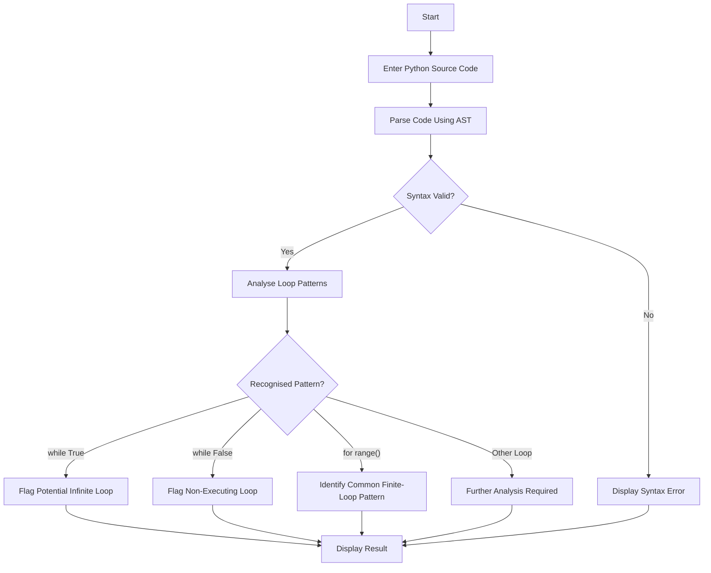

# Infinite Loop Detection in Software

### A Python-Based Static Analysis Approach

## 📌 Project Overview

Infinite Loop Detection in Software is a Python-based project developed as part of the **Formal Language and Automata** course. The project analyses Python source code to identify selected loop patterns that may cause infinite execution.

It uses Python's built-in **Abstract Syntax Tree (AST)** module to examine code structure without executing the program.

## 🎯 Objectives

- Identify common infinite-loop patterns in Python.
- Analyse `while` and `for` loop structures.
- Recognise loops that may not execute.
- Handle invalid Python syntax.
- Understand the relationship between static analysis and Formal Language and Automata concepts.

## 🛠️ Technologies Used

- **Programming Language:** Python
- **Code Analysis:** Abstract Syntax Tree (AST)
- **Platform:** Google Colab
- **Domain:** Formal Language and Automata

## ⚙️ System Workflow



## 🔍 How It Works

1. The user provides Python source code as input.
2. The AST module parses the code into a structured representation.
3. The system checks whether the source code has valid syntax.
4. It examines recognised loop patterns.
5. The system displays a message based on the detected pattern.

## 🧪 Test Cases and Sample Results

| Test Case | Input Pattern | Expected Analysis |
|---|---|---|
| 1 | `for i in range(5):` | Common finite-loop pattern |
| 2 | `while True:` | Potential infinite loop detected |
| 3 | `while False:` | Loop body will not execute |
| 4 | `while x < 10:` | Termination cannot be confirmed by this basic analysis |
| 5 | Invalid Python syntax | Syntax error identified |

### Example 1: Potential Infinite Loop

**Input:**
```python
while True:
    print("Hello")
```

**Sample output:**
```text
Possible infinite loop detected
```

### Example 2: Non-Executing Loop

**Input:**
```python
while False:
    print("Hello")
```

**Sample output:**
```text
Loop body will not execute
```

### Example 3: Common Finite-Loop Pattern

**Input:**
```python
for i in range(5):
    print(i)
```

**Sample analysis:**
```text
Common finite-loop pattern identified
```

*Note: These outputs illustrate the intended analysis messages. Actual output wording may differ slightly depending on the implementation.*

## 📊 Results

The prototype demonstrates how AST-based static analysis can recognise selected loop patterns in Python code. It distinguishes certain suspicious loops from common finite-loop patterns and identifies syntax errors.

The results depend on the patterns implemented in the analyser. They do not establish that every program will terminate.

## ⚠️ Limitations

- It cannot detect every possible infinite loop.
- Conditional loops may require deeper analysis.
- Recognising a `for` loop using `range()` does not guarantee that the entire program terminates.
- It is an educational prototype, not a complete static-analysis tool.

## 📚 Connection to Formal Language and Automata

The project demonstrates the practical application of program analysis and introduces the **Halting Problem**, which establishes that no general algorithm can correctly decide whether every arbitrary program will eventually halt.

This theoretical limitation explains why the prototype focuses on selected loop patterns instead of guaranteeing termination for all programs.

## 🚀 Future Enhancements

- Analyse additional loop patterns.
- Improve detection of nested loops.
- Provide clearer explanations for suspicious code.
- Develop a simple graphical user interface.
- Expand the range of test cases.


## 🏁 Conclusion

This project demonstrates a basic approach to detecting potential infinite loops using Python AST-based static analysis. It connects practical software analysis with Formal Language and Automata concepts while highlighting the limitations of automatic program-termination analysis.
